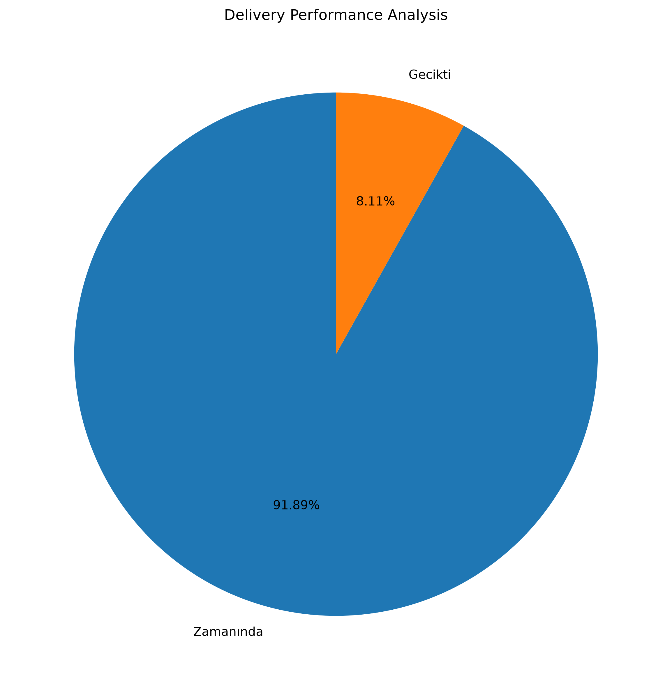
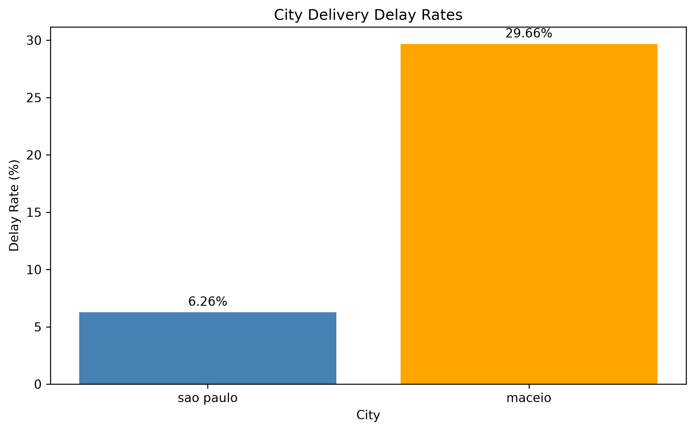
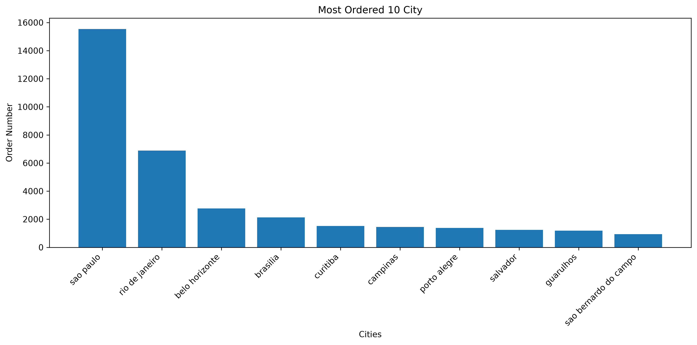
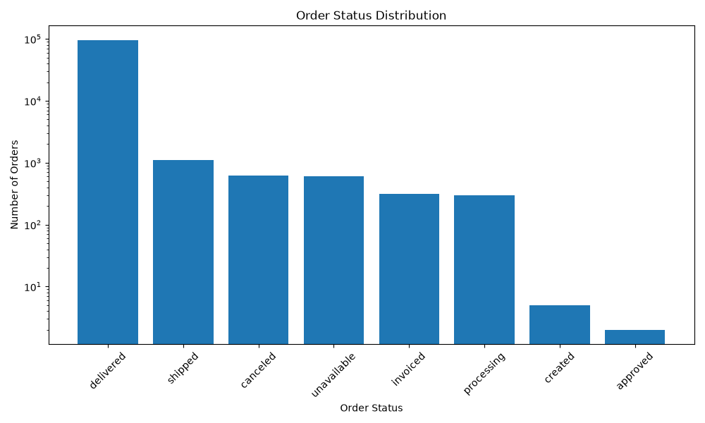

# E-Commerce Data Analysis with SQL & Python

## Project Overview

This project analyzes real-world e-commerce data to evaluate order distribution, delivery performance, and regional delivery delays.

The main objective is to transform raw transactional data into meaningful business insights using SQL and Python.

## Technologies Used

- **MySQL:** Data querying, filtering, joining tables, and aggregation
- **Python:** Data analysis and automation
- **Pandas:** Data manipulation and analysis
- **Matplotlib:** Data visualization
- **Git & GitHub:** Version control and project documentation

## Dataset

This project uses the **Brazilian E-Commerce Public Dataset by Olist**, which contains information about customer orders, delivery dates, and customer locations.

The analysis focuses on order statuses, delivery delays, and city-level logistics performance.

## Key Findings

### 1. Order Delivery Performance

- Total orders analyzed: **99,441**
- Successfully delivered orders: **96,478**
- Delivery completion rate: **97.02%**
- Orders delivered later than the estimated date: **7,826**
- Late delivery rate among delivered orders: **8.11%**
- Average delay among late deliveries: **8.87 days**

### 2. City-Level Delivery Analysis

The analysis revealed an important difference between the number of delayed orders and the percentage of deliveries that were delayed.

| Metric | São Paulo | Maceió |
|---|---:|---:|
| Completed deliveries | 15,045 | 236 |
| Delayed deliveries | 942 | 70 |
| Delay rate | 6.26% | 29.66% |

### 3. Business Insights

São Paulo has a higher number of delayed deliveries, indicating a larger absolute customer impact.

However, Maceió has a significantly higher delay rate, suggesting a greater relative delivery reliability concern.

These findings demonstrate why both absolute order volumes and percentage-based performance indicators are necessary for evaluating logistics operations.

Further investigation into shipping routes, delivery partners, and regional logistics conditions would help identify the underlying causes.


## Data Visualizations

### Delivery Performance

The chart below illustrates the proportion of on-time and delayed deliveries.




### City-Level Delivery Delay Rates

This chart compares the percentage of delayed deliveries in São Paulo and Maceió.

Although São Paulo has more delayed orders, Maceió has a significantly higher delay rate.




### Top 10 Cities by Order Volume

The chart below shows the ten cities with the highest number of orders.



### Order Status Distribution

This chart shows how orders are distributed across different statuses, including delivered, shipped, canceled, and processing.




## Data Source

The dataset used in this project is the Brazilian E-Commerce Public Dataset by Olist.

Dataset link:
https://www.kaggle.com/datasets/olistbr/brazilian-ecommerce

The dataset contains information about orders, customers, products, payments, and deliveries.

The original CSV files are not included in this repository.

To reproduce the analysis, download the dataset and import the required tables into MySQL.


## How to Run the Project

### 1. Clone the repository

```bash
git clone https://github.com/pekcakarcagan-dot/Ecommerce_SQL_Python_Analysis.git
cd Ecommerce_SQL_Python_Analysis
```

### 2. Install Python dependencies

```bash
python3 -m pip install -r requirements.txt
```

### 3. Configure MySQL

- Install and start MySQL Server.
- Create a database named `ecommerce_analysis`.
- Download the Olist dataset from the link above.
- Import the `olist_orders_dataset.csv` and
  `olist_customers_dataset.csv` files into MySQL.
- Name the imported tables `orders` and `customers`.

### 4. Configure environment variables

Copy `.env.example` to `.env`:

```bash
cp .env.example .env
```

Open `.env` and enter your own MySQL credentials.

Never commit your `.env` file to GitHub.

### 5. Run the analyses

```bash
python3 siparis_analizi.py
python3 teslimat_analizi.py
python3 sehir_gecikme_grafigi.py
```

The generated charts are saved in the `Figures/` directory.
